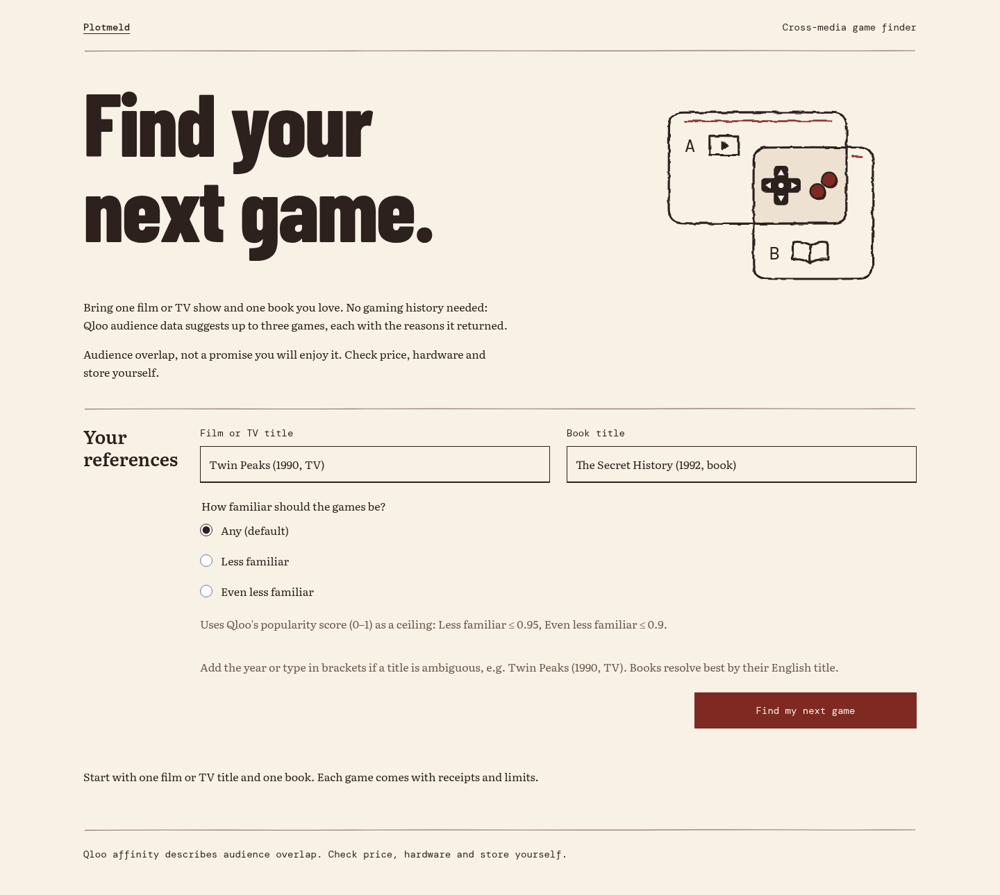

# Plotmeld: find your next game

Live demo: https://plotmeld.vercel.app

Enter one film or TV title and one book. Plotmeld looks both up in Qloo and returns up to three video games in Qloo's affinity order. Each game card lists reasons that cite facts built from the fields Qloo returned. Affinity measures audience overlap and does not guarantee that you will enjoy a game.




## Why Qloo is essential

Qloo decides which games appear and in what order. The language model never picks, ranks, or adds a game. Every fact on a card comes from the Qloo response for that request: the affinity score, the per-input contribution Qloo returns when explainability is on, the game's properties, and its tags. Without Qloo the app has nothing to rank and nothing to cite. A language model on its own could name games that sound like Twin Peaks, but it has no measured audience overlap and cannot tell you whether the book or the show drove a pick.

Each request runs these steps:

1. `GET /search` for the screen title (movie and TV types) and for the book title (book type). An exact name has to match any year or type the user typed. Otherwise the user picks from the returned options, and the agent checks that choice against a fresh search.
2. `GET /v2/insights` with `filter.type=urn:entity:videogame`, both entity IDs in `signal.interests.entities`, `feature.explainability=true`, and `take=10`.
3. Code removes the two input titles and duplicate titles, keeps the top three in Qloo's order, and turns the returned fields into numbered facts.
4. The writer model rewrites those facts as short reasons. A grounding check rejects any reason that cites a fact that isn't there, changes a number, or names something the facts don't contain. A game whose reasons all fail gets one correction turn. After that, the card shows the plain fact text.

The default request applies no popularity filter. The optional familiarity setting adds `filter.popularity.max` to the insights call: 0.95 for "Less familiar" and 0.9 for "Even less familiar". Plotmeld does not filter by genre.

## Run it locally

Use Node.js 22.19 or newer.

```sh
npm ci
QLOO_MODE=mock LLM_PROVIDER=mock npm run dev
```

Mock mode runs offline with synthetic games and facts and needs no keys. Run `npm run typecheck`, `npm run lint`, and `npm test` for the checks.

Live mode requires server-only `QLOO_API_KEY` with `QLOO_MODE=live`. Anthropic wording requires `LLM_PROVIDER=anthropic` and `ANTHROPIC_API_KEY`. Never put credentials in browser configuration. Production builds and the production server refuse mock Qloo mode.

CI runs the typecheck, lint, and tests with the mock Qloo client, then builds with `QLOO_MODE=live`, the same mode production uses. The build makes no Qloo or Anthropic calls, so it needs no keys.

## Contract and limits

The browser calls `runNextGame` with the frozen `NextGameInput` contract. Reports use `ok`, `needs_choice`, `insufficient_candidates`, or `evidence_unavailable`.

Titles can include year and type qualifiers. Ambiguous or alternate-title searches require the user to choose from returned options. The agent revalidates choices against a fresh search.

The agent makes at most eight Qloo attempts and two writer turns per request. Process fuses default to 600 Qloo calls (`QLOO_MAX_CALLS_PER_PROCESS`) and 200 Anthropic calls (`LLM_MAX_CALLS_PER_PROCESS`). These counters reset with the process. The Anthropic account quota remains the spend bound. The default model is `claude-haiku-5-5`, with zero retries, no temperature setting, and a 20-second timeout.

The default example is cached only in server memory for 24 hours after a successful live run. Live bypass and changed inputs remain rate limited. No recorded default report is written to disk.

The live smoke test runs outside CI and needs real keys:

```sh
QLOO_MODE=live LLM_PROVIDER=anthropic SMOKE_PAIRS_FILE=/private/pairs.json SMOKE_OUT_DIR=/private/results npm run smoke:live
```

The pairs file has `{ "pairs": [{ "id": "sample", "references": ["screen title", "book title"], "pick": { "screen": "option substring" } }] }`. The output directory must be outside the repository. The script writes private reports, spaces Qloo fetches by at least 1.15 seconds, stops on credential or rate-limit errors, and prints only aggregate checks.

Prices, hardware requirements, and store availability require the player's own checks. Platforms are copied from Qloo. See [ARCHITECTURE.md](ARCHITECTURE.md) and [LICENSE](LICENSE).
